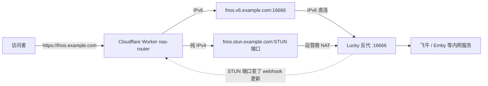

# 飞牛 NAS 单域名双栈智能分流远程访问方案

一个域名，不带端口，就能从外面访问家里的飞牛 NAS。

- 手机 4G/5G、有 IPv6 的网络：走 IPv6 直连，固定端口，满速
- 只有 IPv4 的网络（老旧酒店 Wi-Fi、企业内网）：自动切 STUN 穿透
- 视频流和文件传输全程点对点直连，不经过 Cloudflare 中转

## 原理

入口是 `https://fnos.example.com`（443 端口，Cloudflare 黄云代理，只做跳转）。Cloudflare Worker 看访问者的 IP：

- IP 里有冒号，就是 IPv6：302 跳到 `https://fnos.v6.example.com:16666`
- IP 里没冒号，就是纯 IPv4：302 跳到 `https://fnos.stun.example.com:动态端口`

跳转之后流量直连家里宽带。302 是临时重定向，换网、换端口立即生效，不会缓存旧地址。



原教程（2024 年）的流程图，供对照，里面“Cloudflare 页面规则”那一步现在由 Worker 代替：


图来源：36102025.xyz《LUCKY STUN 穿透 + Cloudflare 页面规则固定和隐藏网页端口》。

下文的 `example.com` 都是占位，换成自己的域名。内网地址、IPv6 地址也按自家实际情况改。

## 需要准备的东西

- 一个托管在 Cloudflare 的域名
- 家里宽带有公网 IPv6，且 NAS 的 IPv6 后缀固定不变
- NAT 是锥形，STUN 能打通（移动部分地区是对称型，打不通就只剩 IPv6 那条腿）
- 飞牛 NAS 上装好 Lucky（Docker 或 ARM64 二进制都行）
- 主路由是 OpenWrt / BleachWrt，光猫桥接、主路由拨号

## 一、Cloudflare DNS：3 条泛域名解析

| 类型 | 名称 | 内容 | 代理状态 | 用途 |
| --- | --- | --- | --- | --- |
| AAAA | `*` | `2001:db8::1` | 已代理（橙色云） | 占位地址，只为触发边缘路由 |
| AAAA | `*.v6` | `2408:xxxx:xxxx:xxxx::26d` | 仅 DNS（灰色云） | NAS 真实公网 IPv6，由 Lucky DDNS 维护 |
| A | `*.stun` | `1.1.1.1` | 仅 DNS（灰色云） | 初始占位，由 Lucky STUN 任务自动更新 |

另外删掉以前测试留下的旧 Page Rules，避免拦截冲突。2025 年 1 月起所有账号都建不了新的页面规则了，已有的照常跑、以后自动迁移；本方案用 Worker 跳转，不需要页面规则。

## 二、Worker：nas-router

1. Cloudflare 后台左侧点 Workers 和 Pages → 创建 → 创建 Worker，起名 `nas-router`，点部署。
2. 点编辑代码，清空默认内容后粘贴 `worker.js` 的内容，再点部署。
3. 进 `nas-router` 的设置 → 变量和机密，加一个文本变量：名字 `STUN_PORT`，值填当前 STUN 公网端口（比如 `26666`），保存并部署。
4. 回域名控制台，进 Workers 路由 → 添加路由：`*.example.com/*`，Worker 选 `nas-router`，保存。
5. 准备 API 权限：主页右侧复制账号 ID；在“我的个人资料 → API 令牌”里确保令牌有“账户 - Worker 脚本 - 编辑”和“区域 - DNS - 编辑”两项权限。

## 三、主路由器防火墙（BleachWrt）

IPv6 公网入站要放行 NAS 的固定后缀地址。STUN 那条腿按 Lucky 官方文档，Lucky 在局域网里时路由侧三选一：DMZ 指到 NAS、转发监听端口、或开 UPnP，具体配法看第四节的两种转发方式，别直接把 16666 从外网转发进来。

1. 网络 → 防火墙 → 端口转发：删掉以前测试建的、把 16666 直接暴露到外网的规则；STUN 监听端口的转发按第四节选的方式配。
2. 网络 → 防火墙 → 通信规则，新建一条入站放行规则：
   - 协议：TCP；源区域：wan；目标区域：lan（别选 Device）
   - 目标地址：`::26d/::ffff:ffff:ffff:ffff`（后缀掩码，运营商换前缀也不失效）
   - 目标端口：`16666`；动作：接受
   - 如果 LuCI 界面不接受这种掩码写法，改用自定义 nft 规则。

## 四、Lucky 配置

### 1. 申请通用泛域名 SSL 证书

Lucky 安全管理 / SSL 证书里加 ACME 证书，验证方式选 Cloudflare，填 API Token，域名列表填 4 行：

```
example.com
*.example.com
*.v6.example.com
*.stun.example.com
```

### 2. 双栈 DDNS

进 Lucky 动态域名（DDNS），配 Cloudflare 解析任务：

- IPv6 DDNS：启用 `{ipv6Addr}`，获取方式选“通过网卡获取”，网卡选 `end0`，IP 匹配正则填 `^2408:.*::26d$`，域名填 `*.v6.example.com`。
- IPv4 DDNS：由下面的 STUN 穿透任务联动更新 `*.stun.example.com` 的 A 记录。

正则里的 `2408` 是移动的前缀，电信是 `240e`、联通是 `2409`，按自家运营商改。

### 3. Web 服务双栈反向代理

Lucky Web 服务里建统一的反向代理监听规则，同时接 IPv6 直连和 STUN 穿透进来的请求：

- 父级规则：监听类型勾选 IPv4/IPv6，监听端口 `16666`。
- 子规则（以飞牛管理后台为例）：
  - 前端地址（一行一个）：`fnos.v6.example.com`、`fnos.stun.example.com`
  - 后端地址：`http://192.168.1.138:5666`（换成自家 NAS 内网地址和飞牛端口），启用“万事大吉”开关。
- 安全加固：安全设置 → 认证设置里开 Basic Auth，设一个独立的网页访问密码。

### 4. STUN 穿透与 Webhook 自动同步端口

STUN 规则分两种接法，先说明白再选，别混着配：

**方式 A：路由器转发（推荐）**

- Lucky STUN 规则里开“不使用 Lucky 内置端口转发”，穿透通道本地端口填一个固定值（建议大于 10240，局域网内唯一，比如 18888）。
- 路由器上建一条端口转发：外网端口填监听端口（18888），内网 IP 填 NAS，内网端口填服务端口 16666。
- 流量不经过 Lucky，NAS CPU 省一跳，还能拿到访问者真实 IP。Lucky 只负责打洞和端口变了发 Webhook。
- 注意：这种方式下 Lucky 的目标地址/目标端口不用填（那两项只在内置转发时必填）；UDP 穿透不支持这种方式，好在我们走的是 TCP。


**方式 B：Lucky 内置转发（先验证用）**

- Lucky STUN 规则里不开“不使用内置端口转发”，目标地址填 `127.0.0.1`，目标端口填 `16666`。
- 路由器侧三选一：DMZ 指到 NAS；或转发监听端口到 NAS 的同一个监听端口（内外端口相同）；或开 UPnP。
- 流量经过 Lucky 转发，NAS CPU 多一跳，访问者真实 IP 拿不到。官方建议新手先用这种方式确认 STUN 能通，再切方式 A。

注意：网上那篇 2024 年教程的文字和截图配的是两种不同的转发方式，别照着混配。开“不使用内置端口转发”时路由转发要指到服务端口（16666）；关着时才指到 Lucky 本机监听端口。混配了流量到 Lucky 监听端口就没人接，访问会失败。

再开 Webhook，STUN 端口变了自动推给 Worker：

- 接口地址：`https://api.cloudflare.com/client/v4/accounts/你的账号ID/workers/scripts/nas-router/settings`
- 请求方法：PATCH
- 请求头：`Authorization: Bearer 你的APIToken`；`Content-Type: multipart/form-data; boundary=----LuckyBoundary`
- 请求主体（`settings` 字段，JSON）：

```json
{"bindings":[{"name":"STUN_PORT","text":"#{port}","type":"plain_text"}]}
```

- 成功判断字符串：`"success":true`

## 五、代理分流与日常使用

代理客户端（v2rayN / Clash）分流规则：把 `domain:v6.example.com` 和 `domain:stun.example.com` 加进 DIRECT，不然这两个直连终点会被代理绕走，入口域名会被强制直连 Cloudflare 边缘节点导致连接重置（ERR_CONNECTION_CLOSED）。

日常使用：不管在哪种网络，浏览器直接打开 `https://fnos.example.com`，不用带端口。

加新服务（比如 Emby）：只需要在 Lucky Web 服务里加一条子规则，前端填 `emby.v6.example.com` / `emby.stun.example.com`，后端填内网地址，然后访问 `https://emby.example.com` 就行。

排障：

- 手机 5G 下直接访问 `https://fnos.v6.example.com:16666`，验 IPv6 链路。
- 纯 IPv4 环境下直接访问 `https://fnos.stun.example.com:当前STUN端口`，验穿透链路。

## 六、上线前检查清单

- NAT 层数：压到 2 层（运营商 NAT + 光猫/路由器 NAT），多层也行但测试结果只反映最差那一层。新版 NAT 测试工具看映射行为：EndpointIndependent 开头（E 开头）能打通，A 开头不行；旧版看类型，不是“对称型”就行。
- 光猫拨号：光猫后台设 DMZ 指到主路由。日志一直刷 `stun public addr check error`、穿透通道失效，就是光猫有隐形防火墙，试试光猫开 DMZ 指到 NAS，或光猫自带的端口映射把 STUN 监听端口映射出去。
- 端口扫描：搭完用在线端口扫描工具扫一下 STUN 公网端口，后端服务开着，应显示开放。
- 端口变化演练：重启一次光猫/路由器，逼 STUN 端口变化，看 Webhook 有没有把新端口同步到 Worker 的 STUN_PORT。
- Webhook 手动测试按钮用的是演示端口 6666，别当真。
- STUN 官方说法是仅用于体验，端口变化没有规律，稳定性不保证；IPv6 那条腿是主力，STUN 是备胎。
- 限制网络：公司、酒店只放行 80/443 的网络，两条腿都可能被挡（跳转后都不是标准端口），这种环境只能走 Cloudflare Tunnel。

## 安全提醒

- 16666 端口写在跳转后的 URL 里，不是真的“隐藏”，安全靠 Lucky 的 Basic Auth 和飞牛登录两层，密码要够强。
- 跳转会把家里的公网 IP（运营商出口 IP 或 IPv6 地址）暴露给访问者，“隐藏”的只是端口号，不是 IP。
- `*.stun.example.com` 的 A 记录靠 Lucky 及时更新，公网 IP 变了有解析到旧 IP 的窗口，TTL 尽量设小（60 秒）。
- 飞牛管理后台建议别放进直连入口，继续走 Cloudflare Tunnel；Emby 这类只读服务走直连没问题。

## 文件说明

- `worker.js`：Worker 路由脚本原文。
- `docs/flow-stun-page-rules.png`：原教程（2024 年）的流程图，页面规则那步已由 Worker 代替。
- `docs/lucky-stun-rule.png`：Lucky STUN 规则截图，路由器转发方式（方式 A）的关键开关。
