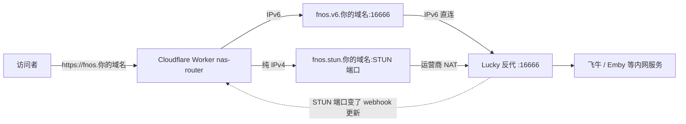
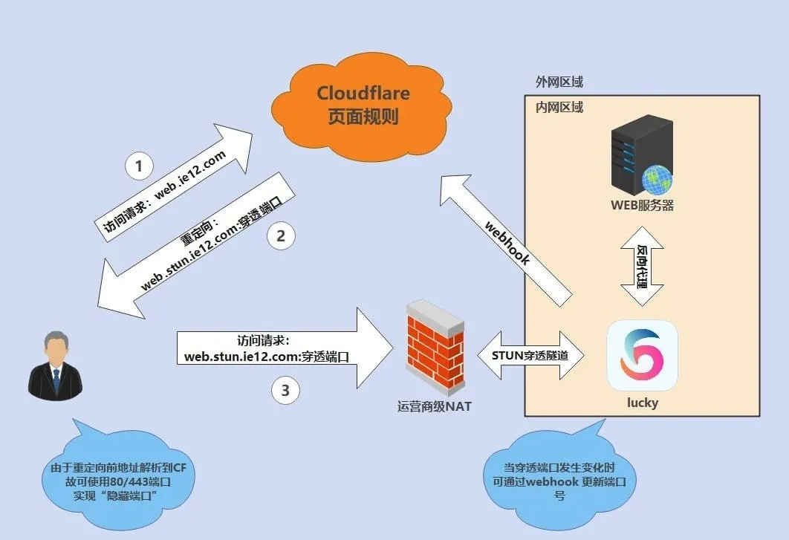
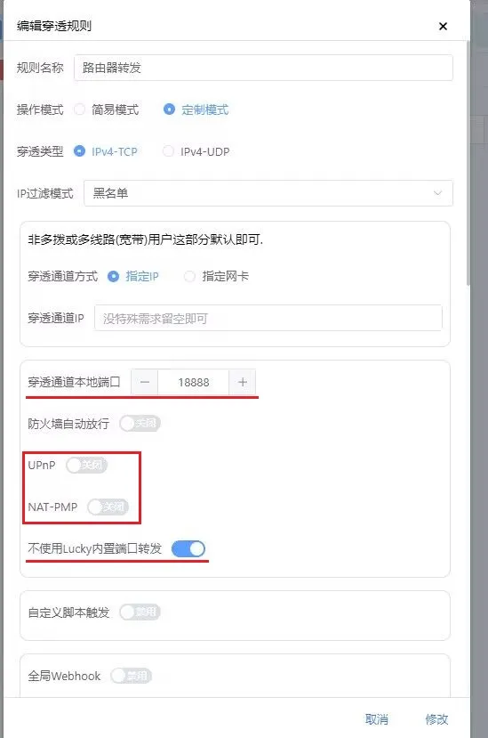

# 飞牛 NAS 单域名双栈远程访问方案

一个域名，不带端口，在外面访问家里的飞牛 NAS。

搭完之后是这样：

- 手机用流量（有 IPv6）：走 IPv6 直连，固定端口，满速
- 只有 IPv4 的网络（老酒店 Wi-Fi、公司网）：自动走 STUN 穿透
- 看视频、传文件都是直连家里，不经过 Cloudflare 中转

全程在网页上点，不用敲命令，不用装软件。

## 先看懂这张图

入口是 `https://fnos.你的域名`（443 端口，Cloudflare 代理，只做跳转）。Cloudflare 上跑着一个叫 Worker 的小程序（nas-router），它看你的 IP：

- IP 里有冒号，就是 IPv6：302 跳到 `https://fnos.v6.你的域名:16666`
- IP 里没冒号，就是纯 IPv4：302 跳到 `https://fnos.stun.你的域名:动态端口`

跳过去之后，流量直接连到家里宽带，不再经过 Cloudflare。302 是临时跳转，换了网、换了端口立刻生效，不会记住旧地址。



原教程（2024 年）的流程图，供对照，里面“Cloudflare 页面规则”那一步现在由 Worker 代替：



图来源：36102025.xyz《LUCKY STUN 穿透 + Cloudflare 页面规则固定和隐藏网页端口》。

下文的 `你的域名` 都是占位，换成自己的域名。内网地址、IPv6 地址也按自家实际情况改。

## 看不懂的词，先看这里

- **域名**：你买的网址，比如 `example.com`。
- **DNS 解析**：把域名翻译成 IP 地址的记录，在 Cloudflare 后台填。
- **黄云 / 灰云**：Cloudflare 里一条解析记录的开关。黄云（已代理）是流量先过 Cloudflare；灰云（仅 DNS）是只查地址、流量直连家里。入口那条必须是黄云，v6 和 stun 那两条必须是灰云。
- **泛域名**：带 `*` 的解析，一条管所有子域名。比如 `*.v6.你的域名`，`fnos.v6.你的域名`、`emby.v6.你的域名` 都归它管。
- **Worker**：Cloudflare 上跑的一段小程序，这里只干一件事：看访问者是 IPv6 还是 IPv4，然后跳转。
- **DDNS**：家里 IP 变了，自动去改解析记录，不用手动改。
- **STUN 穿透**：家里没有公网 IPv4 时用的打洞办法，让外面能连进来。端口会不定期变化，所以要配 Webhook 自动同步。
- **反向代理**：Lucky 里的一道门，外面来的请求先到它，再由它转给飞牛、Emby 这些内网服务。
- **Webhook**：STUN 端口变了，Lucky 自动给 Cloudflare 发一条通知，把新端口写进 Worker 的变量里。

## 开始之前，先准备好这些

缺一样就先补齐，别跳过：

1. **一个域名，已经托管在 Cloudflare**，状态是 Active（在域名控制台能看到）。域名还没买的先买，买完按 Cloudflare 的提示改 NS，等激活。
2. **家里宽带有公网 IPv6，后缀固定不变**。自查：路由器后台看 WAN 口有没有 `2408`、`240e`、`2409` 开头的地址，有就是有；或者手机关 Wi-Fi 打开 test-ipv6.com，看有没有显示 IPv6 地址。
3. **NAT 是锥形**。自查：Lucky 自带 NAT 测试工具（在 STUN 穿透页面里），新版看映射行为，E 开头能打通，A 开头不行；旧版看类型，不是“对称型”就行。移动部分地区是对称型，打不通就只剩 IPv6 那条腿。
4. **飞牛 NAS 上装好 Lucky**（Docker 或 ARM64 二进制都行）。
5. **主路由是 OpenWrt / BleachWrt**，光猫桥接、主路由拨号。
6. **一台能上网的电脑或手机**。下面每一步做完都有“怎么验证”，做完就验，别攒到最后。

## 第一步：Cloudflare DNS，加 3 条解析

Cloudflare 后台 → 左侧点你的域名 → 左侧 DNS → 记录 → 添加记录，一条条加：

| 类型 | 名称 | 内容 | 代理状态 | 是干什么的 |
| --- | --- | --- | --- | --- |
| AAAA | `*` | `2001:db8::1` | 已代理（橙色云） | 占位地址，只为触发跳转 |
| AAAA | `*.v6` | NAS 当前的 IPv6 地址 | 仅 DNS（灰色云） | NAS 真实公网 IPv6，之后 DDNS 自动更新 |
| A | `*.stun` | 当前公网 IPv4 地址 | 仅 DNS（灰色云） | 初始占位，之后 STUN 任务自动更新 |

填的时候注意：

- 名称填 `*`，Cloudflare 会自动补成 `*.你的域名`；填 `*.v6` 也一样。
- NAS 当前的 IPv6 地址去路由器后台看，找 NAS 那台设备的地址，`2408:xxxx:xxxx:xxxx::26d` 这种格式。
- 当前公网 IPv4 地址百度搜“我的 IP”就能看到。
- 代理状态别点错：入口那条是橙色云，v6 和 stun 那两条是灰色云。灰云点错成橙色云，流量进不了家里。

**怎么验证**：3 条记录都出现在列表里，代理状态那一列的颜色对得上，就可以往下走。

## 第二步：Worker，建 nas-router

### 2.1 建 Worker，粘贴代码

1. Cloudflare 后台左侧点 Workers 和 Pages → 创建 → 创建 Worker，起名 `nas-router`，点部署。
2. 点编辑代码，把里面默认的代码全删掉，粘贴 `worker.js` 的内容，再点部署。

### 2.2 设两个变量

进 `nas-router` 的设置 → 变量和机密，点添加变量，加两个文本变量，保存并部署：

- `STUN_PORT`：值填当前 STUN 公网端口。去 Lucky → STUN 内网穿透 → 规则列表里看这条规则的公网地址，冒号后面的数字就是端口，比如 `26666`。这个值以后由 Webhook 自动更新，不用手动改。
- `BASE_DOMAIN`：值填自己的域名，只填域名，比如 `example.com`，不带 `https://`。不填也行，Worker 会自动从访问的域名去掉第一段得到，访问 `fnos.example.com` 就得到 `example.com`。

### 2.3 加路由

回域名控制台，进 Workers 路由 → 添加路由：路由填 `*.你的域名/*`，Worker 选 `nas-router`，保存。

### 2.4 准备 API 令牌和账号 ID（后面几步要用）

- 账号 ID：域名控制台右侧边栏能看到，复制下来。
- API 令牌：右上角头像 → 我的个人资料 → API 令牌 → 创建令牌 → 自定义令牌。权限加两项：“账户 - Worker 脚本 - 编辑”和“区域 - DNS - 编辑”，区域资源选你的域名（或所有区域）。点继续，复制令牌保存好，**令牌只显示一次**，关掉就再也看不到了。

**怎么验证**：手机用流量打开 `https://fnos.你的域名`，地址栏变成带端口的地址（v6 或 stun），就说明 Worker 已经在工作了。这时页面打不开是正常的，因为第四步还没做。

## 第三步：路由器设置（OpenWrt / BleachWrt）

路由器这边有四件事：确认光猫是桥接、确认 IPv6 通了、把 NAS 的 IPv6 后缀固定下来、放行 IPv6 入站。STUN 那条腿的转发规则在第四步 4.4 节按你选的方式配。

### 3.1 先确认光猫是桥接、路由器在拨号

路由器后台 → 状态 → 总览，看 WAN 口的 IPv4 地址：

- 是公网地址（不是下面这三类），就是桥接没问题。
- 是 `192.168.x.x`、`10.x.x.x`，说明光猫还在路由模式，没桥接，去光猫后台改成桥接，让路由器拨号。
- 是 `100.64.x.x`，说明运营商给了大内网地址（CGNAT），IPv4 那条腿只能走 STUN，IPv6 那条腿不受影响。

### 3.2 确认 IPv6 已经通了

路由器后台 → 网络 → 接口：

- WAN6 那一行有 IPv6 地址，下面还写着已委派的前缀（比如 `2408:xxxx:xxxx:xx00::/56`），就是通了。
- LAN 那一行有 IPv6 地址，说明内网已经分到 IPv6 了。
- 如果 WAN6 没有地址，先去确认光猫桥接没问题（3.1）；如果 LAN 没有 IPv6，进 LAN → 编辑 → DHCP 服务器 → IPv6 设置，把 RA 服务和 DHCPv6 服务都改成“服务器模式”，一般设置里的 IPv6 分配长度填 `64`，保存并应用。

### 3.3 把 NAS 的 IPv6 后缀固定下来

整个方案都指望 NAS 的 IPv6 后缀不变（DDNS 正则和防火墙规则都写了 `::26d`）。先看稳不稳：记下 NAS 现在的 IPv6 地址，重启一次 NAS 和路由器，再看一遍，后缀没变就不用管，直接往下走。

如果变了，在路由器上给 NAS 做静态租约：

1. 路由器后台 → 网络 → DHCP 和 DNS → 活动租约 → DHCPv6 租约，找到 NAS 那条，复制它的 DUID（一长串十六进制）。
2. 同一页往下翻到静态租约，点添加：如果有 DUID 那一栏，填 DUID，IPv6 后缀填 `26d`（就是 `::26d` 去掉冒号），保存并应用。
3. 如果静态租约里没有 DUID 这一栏（原版 LuCI 没有），用路由器上的 TTYD 网页终端（一般在 服务 → 终端），粘贴下面这几行，DUID 和后缀按自家的改：

```
uci add dhcp host
uci set dhcp.@host[-1].name='nas'
uci set dhcp.@host[-1].duid='000100004fd454041c6f65d26f43'
uci set dhcp.@host[-1].hostid='26d'
uci commit dhcp
/etc/init.d/odhcpd restart
```

上面第三行的 DUID 只是个例子，改成你从租约列表复制的那串；第四行的 `26d` 是后缀，按自家的改。改完重启一次 NAS，再看地址，后缀就钉住不动了。

### 3.4 放行 IPv6 入站

IPv6 公网进来的请求，要在路由器上放行 NAS 的固定后缀地址。

1. 路由器后台 → 网络 → 防火墙 → 通信规则 → 添加。
2. 这样填：
   - 名称：随便填，比如 `放行NAS-IPv6`
   - 协议：TCP
   - 源区域：wan
   - 目标区域：lan（别选 Device）
   - 目标地址：`::26d/::ffff:ffff:ffff:ffff`
   - 目标端口：`16666`
   - 动作：接受
3. 保存并应用。

目标地址里 `::26d` 是 NAS 的 IPv6 后缀，去路由器后台看 NAS 的 IPv6 地址，最后一段就是后缀，按自家的改。后面的 `/::ffff:ffff:ffff:ffff` 是后缀掩码，运营商换前缀也不失效。

如果 LuCI 界面不接受这种掩码写法，就把目标地址只填 NAS 完整的 IPv6 地址（比如 `2408:xxxx:xxxx:xxxx::26d`），先跑起来。运营商换前缀后这条规则要手动改一次。

STUN 那条腿不用在这里加端口转发，转发规则在第四步 4.4 节按你选的方式配，别直接把 16666 从外网转发进来。

## 第四步：Lucky 配置

### 4.1 申请证书

Lucky → 安全管理 → SSL 证书 → 添加 ACME 证书：

- 验证方式选 Cloudflare，API Token 填第二步准备好的令牌。
- 域名列表填 4 行，一行一个：

```
你的域名
*.你的域名
*.v6.你的域名
*.stun.你的域名
```

点申请，等证书签下来。通配符只管一层，`*.你的域名` 盖不住 `fnos.v6.你的域名`，所以 v6 和 stun 那两行必须单独写。

### 4.2 DDNS，让解析记录自己更新

Lucky → 动态域名（DDNS）→ 添加 Cloudflare 解析任务：

**IPv6 那条**：

- 启用 `{ipv6Addr}`。
- 获取方式选“通过网卡获取”，网卡选 NAS 的网卡（一般是 `end0`，按自家的选）。
- IP 匹配正则填 `^2408:.*::26d$`。`2408` 是运营商前缀，移动是 `2408`、电信是 `240e`、联通是 `2409`，按自家改；`::26d` 是 NAS 的 IPv6 后缀，按自家改。
- 域名填 `*.v6.你的域名`。

**IPv4 那条**：不用单独建，由下面的 STUN 穿透任务联动更新 `*.stun.你的域名` 的 A 记录。

### 4.3 反向代理，接两条腿进来的请求

Lucky → Web 服务 → 添加监听规则：

- 父级规则：监听类型勾选 IPv4/IPv6，监听端口 `16666`。
- 子规则（以飞牛管理后台为例）：
  - 前端地址，一行一个：`fnos.v6.你的域名`、`fnos.stun.你的域名`
  - 后端地址：`http://192.168.1.138:5666`，`192.168.1.138` 换成自家 NAS 内网地址，`5666` 换成飞牛端口，启用“万事大吉”开关。
- 安全加固：安全设置 → 认证设置 → 开 Basic Auth，设一个独立的网页访问密码，别跟飞牛登录密码用同一个。

### 4.4 STUN 穿透，两种接法先说明白再选

Lucky → STUN 内网穿透 → 添加穿透规则。两种接法，**别混着配**。规则里的“防火墙自动放行”保持关闭（Lucky 不在路由器上跑，这个开关没用）。

**方式 A：路由器转发（推荐）**

- 规则里开“不使用 Lucky 内置端口转发”。
- 穿透类型选 IPv4-TCP。
- 穿透通道本地端口填一个固定值，建议大于 10240、局域网内唯一，比如 `18888`。
- 路由器上建一条端口转发：路由器后台 → 网络 → 防火墙 → 端口转发 → 添加，这样填：名称随便（比如 `STUN-18888`），协议 TCP，源区域 wan，外部端口 `18888`，目标区域 lan，内网 IP 填 NAS 的内网地址，内部端口 `16666`，保存并应用。
- 流量不经过 Lucky，NAS CPU 省一跳，还能拿到访问者真实 IP。Lucky 只负责打洞和端口变了发 Webhook。
- 注意：这种方式下 Lucky 的目标地址、目标端口不用填（那两项只在内置转发时必填）；UDP 穿透不支持这种方式，好在我们走的是 TCP。



**方式 B：Lucky 内置转发（先验证用）**

- 规则里不开“不使用内置端口转发”，目标地址填 `127.0.0.1`，目标端口填 `16666`。
- 路由器侧三选一：
  - DMZ 指到 NAS：路由器后台 → 网络 → 防火墙 → 端口转发 → 添加，协议选 Any，源区域 wan，目标区域 lan，外部端口和内部端口都留空（表示全部端口），内网 IP 填 NAS，保存并应用。**这条规则要放在端口转发列表的最下面**，不然它后面的规则都不生效。
  - 转发监听端口：同一页添加一条，协议 TCP，源区域 wan，外部端口填监听端口，目标区域 lan，内网 IP 填 NAS，内部端口填同一个监听端口（内外端口相同）。
  - 开 UPnP：路由器后台 → 服务 → UPnP，勾选启用，保存并应用（没有 UPnP 这一项，先在 系统 → 软件包 里装 luci-app-upnp）；同时把 Lucky 规则里的 NAT-PMP 开关打开，让 Lucky 配合 UPnP 自动在路由器上建转发。
- 流量经过 Lucky 转发，NAS CPU 多一跳，访问者真实 IP 拿不到。官方建议新手先用这种方式确认 STUN 能通，再切方式 A。

注意：网上那篇 2024 年教程的文字和截图配的是两种不同的转发方式，别照着混配。开“不使用内置端口转发”时路由转发要指到服务端口（16666）；关着时才指到 Lucky 本机监听端口。混配了流量到 Lucky 监听端口就没人接，访问会失败。

### 4.5 Webhook，STUN 端口变了自动同步

还是在 STUN 规则里，开 Webhook，照下面填：

- 接口地址：`https://api.cloudflare.com/client/v4/accounts/你的账号ID/workers/scripts/nas-router/settings`
- 请求方法：PATCH
- 请求头（两行）：
  - `Authorization: Bearer 你的APIToken`
  - `Content-Type: multipart/form-data; boundary=----LuckyBoundary`
- 请求主体（`settings` 字段，JSON）：

```json
{"bindings":[{"name":"STUN_PORT","text":"#{port}","type":"plain_text"}]}
```

- 成功判断字符串：`"success":true`

填完点手动测试，返回里有 `"success":true` 就是通了。注意手动测试按钮用的是演示端口 6666，Worker 的变量会被写成 6666，别当真，等 STUN 端口下次真变了会自动改回来；也可以手动去 Worker 变量里把 STUN_PORT 改回当前端口。

**怎么验证**：手机用流量打开 `https://fnos.你的域名`，应该跳到 v6 地址并打开飞牛登录页。找个纯 IPv4 环境（把手机 IPv6 关掉，或用公司网）再打开一次，应该跳到 stun 地址并打开。两边都通了就成功了。

## 第五步：手机和电脑上的分流设置

不加这一步，`v6.你的域名` 和 `stun.你的域名` 这两个直连终点会被代理绕走，入口域名会被强制直连 Cloudflare 边缘节点导致连接重置（ERR_CONNECTION_CLOSED）。

**Clash**：配置文件里加两条规则，放在代理规则前面：

```
- DOMAIN-SUFFIX,v6.你的域名,DIRECT
- DOMAIN-SUFFIX,stun.你的域名,DIRECT
```

**v2rayN**：设置 → 路由设置 → 添加直连规则，域名填 `domain:v6.你的域名` 和 `domain:stun.你的域名`。

日常使用：不管在哪种网络，浏览器直接打开 `https://fnos.你的域名`，不用带端口。

加新服务（比如 Emby）：只需要在 Lucky Web 服务里加一条子规则，前端填 `emby.v6.你的域名` / `emby.stun.你的域名`，后端填内网地址，然后访问 `https://emby.你的域名` 就行。

## 第六步：上线前检查清单

一项项过，全打勾再算完工：

- [ ] NAT 层数压到 2 层（运营商 NAT + 光猫/路由器 NAT）。多层也行，但测试结果只反映最差那一层。
- [ ] 光猫拨号：光猫后台设 DMZ 指到主路由。日志一直刷 `stun public addr check error`、穿透通道失效，就是光猫有隐形防火墙，试试光猫开 DMZ 指到 NAS，或光猫自带的端口映射把 STUN 监听端口映射出去。
- [ ] 端口扫描：搭完用在线端口扫描工具扫一下 STUN 公网端口，后端服务开着，应显示开放。
- [ ] 端口变化演练：重启一次光猫/路由器，逼 STUN 端口变化，看 Webhook 有没有把新端口同步到 Worker 的 STUN_PORT。
- [ ] STUN 官方说法是仅用于体验，端口变化没有规律，稳定性不保证；IPv6 那条腿是主力，STUN 是备胎。
- [ ] 限制网络：公司、酒店只放行 80/443 的网络，两条腿都可能被挡（跳转后都不是标准端口），这种环境只能走 Cloudflare Tunnel。

## 常见问题

**打开入口一直转圈 / 打不开**

先看 Worker 路由 pattern 是不是 `*.你的域名/*`，再看 DNS 里入口那条是不是黄云，最后看 STUN_PORT 是不是当前端口。这三处最容易错。

**IPv6 跳过去打不开**

按顺序查：路由器防火墙那条放行规则在不在、目标地址和端口对不对；Lucky DDNS 的 AAAA 记录是不是 NAS 当前的 IPv6；Lucky 反代前端地址有没有加 v6 域名那行；证书域名列表有没有 `*.v6.你的域名` 那行。

**STUN 跳过去打不开**

先去 Lucky → STUN 内网穿透 → 规则日志里看有没有访问记录。没有记录，就是 NAT 或路由的问题：DMZ、转发、UPnP 三选一有没有配对，NAT 类型是不是对称型。有记录，就是 Lucky 反代或证书的问题，按上一条查。

**换了端口后还是跳旧端口**

Webhook 没同步成功。去 Lucky 看 Webhook 日志和成功判断，令牌权限、账号 ID、Worker 名字有一个错就同步不上。应急办法：手动去 Worker 变量里把 STUN_PORT 改成当前端口。

**NAS 的 IPv6 地址变了，DDNS 和防火墙都对不上**

重启 NAS 或路由器后后缀变了，就是没固定住。按第三步 3.3 节给 NAS 做静态租约，把后缀钉住；再去 Lucky DDNS 和防火墙规则里核对一次后缀。

**提示证书错误**

证书域名列表漏了 v6 或 stun 那行；或者 ACME 申请失败，看令牌有没有“区域 - DNS - 编辑”权限，区域资源包不包含你的域名。

**令牌权限不够**

令牌是在“我的个人资料 → API 令牌”里建的自定义令牌，权限要同时有“账户 - Worker 脚本 - 编辑”和“区域 - DNS - 编辑”，区域资源要包含你的域名。换了域名要把新域名加进区域资源，不然令牌在新域名上用不了。

## 老用户：以前按页面规则搭的 / 想换域名

**以前按 2024 年那篇教程（页面规则）搭的**：页面规则不用急着删，Worker 会先接管，页面规则就变摆设了。先把 Webhook 改成第四步 4.5 节的 Worker 接口，验证两边都通了，再删页面规则。2025 年 1 月起所有账号都建不了新的页面规则了，新搭直接用 Worker。

**想换域名**：新域名上一套：DNS 3 条记录、Worker 加一条新路由、BASE_DOMAIN 改成新域名、反代前端地址改成新域名、证书加上新域名的泛域名、STUN 联动更新改成新域名的 `*.stun` 记录、令牌区域资源加上新域名。两个域名可以并行跑一段时间，验证新域名通了再删旧的。STUN 隧道本身不用重搭，端口也不会变。

## 安全提醒

- 16666 端口写在跳转后的 URL 里，不是真的“隐藏”，安全靠 Lucky 的 Basic Auth 和飞牛登录两层，密码要够强。
- 跳转会把家里的公网 IP（运营商出口 IP 或 IPv6 地址）暴露给访问者，“隐藏”的只是端口号，不是 IP。
- `*.stun.你的域名` 的 A 记录靠 Lucky 及时更新，公网 IP 变了有解析到旧 IP 的窗口，TTL 尽量设小（60 秒）。
- 飞牛管理后台建议别放进直连入口，继续走 Cloudflare Tunnel；Emby 这类只读服务走直连没问题。

## 文件说明

- `worker.js`：Worker 路由脚本原文，直接粘贴到 Worker 里用。域名走 `BASE_DOMAIN` 变量，不填自动从访问域名去掉第一段得到。
- `docs/flow-stun-page-rules.png`：原教程（2024 年）的流程图，页面规则那步已由 Worker 代替。
- `docs/lucky-stun-rule.png`：Lucky STUN 规则截图，路由器转发方式（方式 A）的关键开关。
